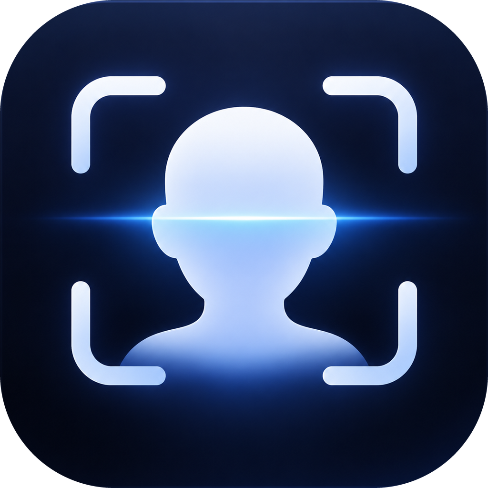

# FaceUnlock for macOS

<p align="center">
  
</p>

一款轻量级的 macOS 菜单栏人脸解锁工具，基于 Swift、AppKit 和 Apple Vision 框架构建。

无需 Electron、无需捆绑机器学习模型、无需第三方运行时环境，也不需要网络连接。所有人脸识别和匹配操作均在本地设备完成。

> **安全警告**
>
> 本项目仅提供便捷的解锁体验，并不意味着提升了系统的安全性。
>
> Mac 并不具备 Face ID 硬件。本项目使用设备内置的二维摄像头进行人脸识别，存在通过视频回放欺骗识别系统的可能性。
>
> 为了实现自动解锁，应用会使用本地密钥加密存储你的 macOS 登录密码，并通过辅助功能（Accessibility API）在锁屏界面模拟键盘输入。
>
> 请自行评估使用风险。如果你需要真正可靠的安全保护，请使用 Touch ID 或强密码。

## 功能特性

- 基于 Apple Vision 实现本地人脸录入与特征匹配。
- 纯菜单栏应用：扫描期间显示菜单栏图标，解锁成功后 3 秒自动隐藏。
- 支持锁屏和唤醒事件触发人脸识别。
- 支持可选的锁屏自动输入密码功能。
- 使用加密方式存储本地人脸特征模板和密码，摄像头采集的图像帧不会写入磁盘。
- 自带透明圆角 App 图标，并附带同款 DMG 卷图标。
- 支持通过 `SMAppService` 设置登录时自动启动，同时提供 LaunchAgent 备用方案。
- 资源占用轻量：应用体积约 1.2 MB（含图标），空闲内存约 40 MB，空闲 CPU 占用率为 0%。

## 工作原理

1. **人脸录入**：采集单个人脸的 30 帧图像，分辨率为 640×480，并从中提取最多 8 个人脸特征原型进行存储。
2. **人脸检测**：在锁屏或系统唤醒时启动摄像头采集，要求画面中必须恰好存在一张人脸，并计算当前人脸特征与已存储特征原型之间的最小欧几里得距离。
3. **身份匹配**：满足单帧强匹配条件，或连续两次匹配成功后，触发解锁流程。
4. **自动解锁**：如果启用了自动输入密码功能，并且已经获得辅助功能权限，应用会自动输入本地存储的密码并按下回车键。
5. **菜单栏管理**：扫描过程中显示菜单栏图标。如果用户没有主动打开菜单，解锁成功 3 秒后自动隐藏图标。

## 环境要求

- macOS 15 或更高版本。
- Xcode 16 或更高版本（推荐使用 Swift 6 工具链）。
- 摄像头访问权限。
- 辅助功能权限（仅在启用自动输入密码功能时需要）。
- 管理员账户（将应用安装到 `/Applications` 目录时需要）。

## 项目构建

克隆项目后，在项目根目录执行以下命令：

```bash
./scripts/build_app.sh
./scripts/package_dmg.sh v0.1.1
open dist/FaceUnlock.app
```

构建完成后，DMG 安装包中将包含：

- `FaceUnlock.app`：应用程序本体。
- `Applications` 快捷方式：用于将应用拖入应用程序目录。

项目使用 Ad-hoc（临时）代码签名。

应用程序包在运行期间保持不可变，所有需要修改的数据均存储在 Application Support 目录中。

## 安装

执行以下命令，将应用复制到 macOS 的应用程序目录并启动：

```bash
cp -R dist/FaceUnlock.app /Applications/
open /Applications/FaceUnlock.app
```

如果需要公开分发项目，请将 `CFBundleIdentifier` 从：

```text
com.local.faceunlock
```

修改为你自己拥有的反向 DNS 格式标识符，然后重新构建，并使用 Developer ID 证书进行正式签名。

由于当前构建使用 Ad-hoc 签名，首次启动时可能需要在 Finder 中右键点击应用，并选择「打开」。

## 权限说明

| 权限 | 用途 |
|---|---|
| 摄像头（Camera） | 采集图像帧，用于人脸检测与特征匹配 |
| 辅助功能（Accessibility） | 仅在启用自动输入密码功能时，用于在锁屏界面模拟键盘输入 |
| 登录项（Login Item） | 可选，用于实现系统登录后自动启动 |

## 数据存储位置

应用的本地数据存储在以下目录：

```text
~/Library/Application Support/FaceUnlock/
├── key.bin          # 本地加密密钥
├── profile.bin      # 人脸特征模板
├── credential.bin   # 加密后的登录密码
└── settings.json    # 应用配置文件

~/Library/Logs/FaceUnlock/FaceUnlock.log
```

应用不会保存摄像头采集的原始图像。

本地仅保存人脸特征向量、经过加密的登录密码以及应用配置。

## 卸载

1. 打开菜单栏中的应用菜单，选择 **Clear All Data and Quit（清除所有数据并退出）**。
2. 删除 `/Applications/FaceUnlock.app`。
3. 如果系统设置中仍然保留 Camera 或 Accessibility 相关权限记录，可以在系统设置中手动移除。

## 安全模型与局限性

- **人脸数据本地化**：仅保存人脸特征向量，不保存原始人脸图像。
- **密码加密存储**：登录密码使用 AES-GCM 加密，密钥存储在同一个本地数据目录中。这种设计可以防止普通的明文文件查看，但无法防御以当前用户身份运行的本地攻击者。
- **自动输入默认关闭**：自动输入密码功能默认处于关闭状态，必须由用户主动启用，并授予相应的辅助功能权限。
- **完全离线运行**：项目不包含网络通信代码，不会向外部发送遥测数据。
- **无法可靠抵御照片或视频欺骗**：普通二维摄像头无法可靠地区分真实的人脸与视频回放，因此本项目不等同于 Apple 的 Touch ID 或 Face ID。
- **特征提取的局限性**：使用的 Feature Print 是一种通用图像特征描述符，并非专门针对人脸识别训练的模型。识别阈值需要根据实际使用环境进行校准。
- **代码签名限制**：当前版本使用 Ad-hoc 签名。重新构建应用会改变代码签名，可能导致 macOS 重置此前授予的隐私权限。

## 项目结构

```text
Sources/FaceUnlock/       Swift 源代码
Resources/Info.plist      应用程序包元数据
scripts/build_app.sh      构建应用程序
scripts/package_dmg.sh   打包 DMG 安装文件
docs/DESIGN.zh-CN.md      中文开发设计文档
```

## 开源协议

本项目采用 **MIT License** 开源协议。

详见 [LICENSE](LICENSE) 文件。

## 商标声明

本项目与 Apple Inc. 没有任何关联。

「Face ID」是 Apple Inc. 的注册商标。本项目命名为 FaceUnlock，旨在避免与 Apple 的官方产品产生混淆。
